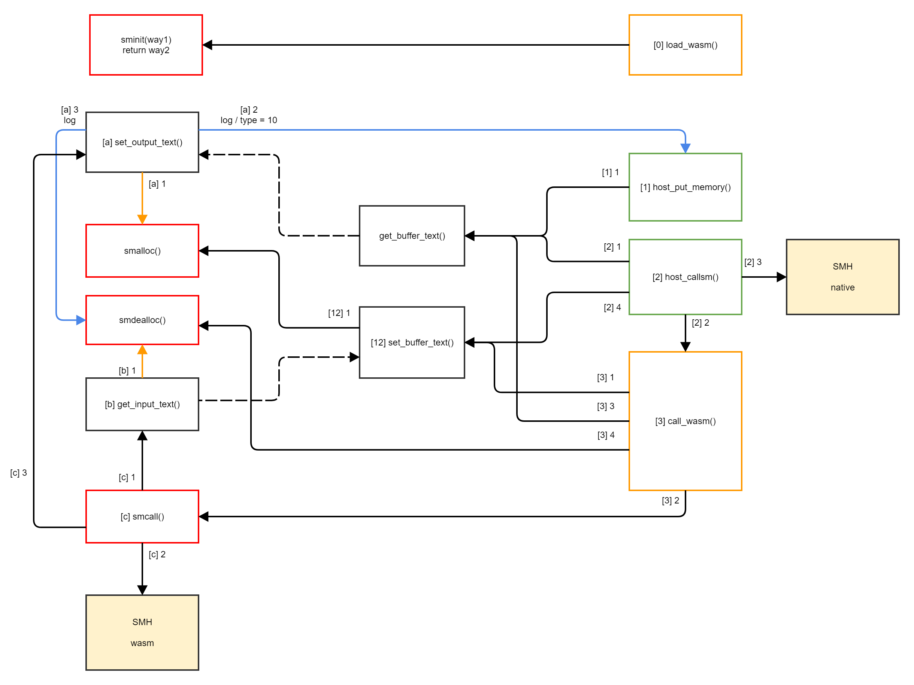

# smlibrbase

SmartModule base library for WebAssembly. It connects SmartModule execution to host-provided callbacks and supports JSON text and DTON binary messages.

## Public API by Module

All public functions and the `ISmLibrSupport` trait are exposed at the crate root (`smlibrbase::`). The modules below group the API by responsibility; the source modules `init`, `support`, `usesm`, and `smcallout` are private.

### Initialization

| Function | Description |
| --- | --- |
| `init(opsupport: Option<Box<dyn ISmLibrSupport>>) -> bool` | Installs host callbacks and connects logging and timing to `smcore`. With `Some`, first invokes `smdebug(0, 0)`. With `None`, leaves the current configuration unchanged. Always returns `true`. |
| `is_init(name: &String) -> bool` | Returns whether the given module name has been initialized. |
| `set_init(name: &String, _way: i32)` | Marks a module name as initialized, selects the global message format, and registers `smker.callsm` for outbound host calls. Repeated calls for the same name have no effect. |

For `set_init`, setting bit `0x100` in `_way` selects DTON binary messages; leaving it clear selects JSON text. The format is shared across module names. Before the first `set_init` call, the default is binary.

### Memory Management

| Function | Description |
| --- | --- |
| `base_alloc_a(len: usize) -> i32` | Allocates a payload of `len` bytes with a four-byte little-endian length prefix. Returns the address of the prefix, or `0` if allocation fails. |
| `base_dealloc_d(poff: i32)` | Frees a buffer allocated by `base_alloc_a`, using its length prefix. Passing `0` has no effect. |

These functions use 32-bit addresses for the WebAssembly memory interface. The payload starts at `poff + 4`; the length prefix stores the payload size. Use valid library-allocated buffers and release each allocation exactly once.

### SmartModule Execution

| Function | Description |
| --- | --- |
| `call(poff: i32, work: i32) -> i32` | Consumes and frees the input buffer, processes it using the selected message format, and returns an allocated output buffer. With `work > 0`, dispatches to `smcore::smh.call`; otherwise, returns the input data with `$work` set to `false` and `$ms` set to the current time as a string. |

Host support must be installed before calling `call`. Without it, `call` returns `0` and leaves the input buffer untouched. Invalid JSON also returns `0`, after consuming the input. Successful output is reported through `put_memory` with type `1`; release the returned buffer with `base_dealloc_d` after reading it.

### Host Support: `ISmLibrSupport`

Implement this `Sync + Send` trait and pass it to `init` to provide host services.

| Method | Description |
| --- | --- |
| `smdebug(&self, d1: i32, d2: i32)` | Receives debug values. Called with `(0, 0)` when host support is installed. |
| `get_ms(&self) -> i64` | Supplies the current time in milliseconds for SmartModule timing. |
| `put_memory(&self, d1: i32, d2: i32)` | Receives a buffer address in `d1` and a purpose code in `d2`: `0` for outbound call input, `1` for execution output, and `10` for log text. |
| `callsm(&self, d1: i32) -> i32` | Executes an outbound host call using the input buffer at `d1` and returns a response buffer in the selected message format. |

For outbound calls, the library frees both the request buffer and the returned response buffer. The host must return a compatible library-allocated response and must not free the request itself. Log buffers are freed immediately after `put_memory` returns, so copy log data during the callback if needed.

### Registered SmartModule Operation

| Operation | Description |
| --- | --- |
| `smker.callsm` | Registered by `set_init`. Forwards a SmartModule request to the host through `ISmLibrSupport::callsm` and converts the response back into a DTON buffer. The request uses `$usage` to identify the target operation. |

## Call Flow

